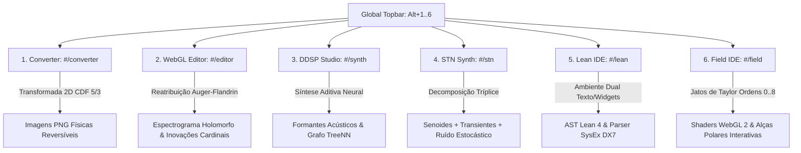

# 🎨🔊 Spectral

[](https://github.com/racoci/spectral/actions/workflows/deploy.yml)
[](https://svelte.dev/)
[](https://www.rust-lang.org/)
[](https://rustwasm.github.io/wasm-pack/)
[](https://opensource.org/licenses/MIT)

**Spectral** é uma suíte de engenharia de áudio e síntese baseada em **Geometria Holomorfa**, **Mínimo Comprimento de Descrição (MDL)** e **Processamento de Sinais Bit-Perfect**. A plataforma combina núcleos de alto desempenho compilados em **Rust / WebAssembly** com uma interface reativa moderna construída em **Svelte 5** e aceleração de tela via **WebGL 2.0 (GLSL 3.0 ES)**.

A aplicação é executada 100% no cliente (client-side) e é implantada de forma contínua no **GitHub Pages**.

---

## 🗺️ As 6 Ferramentas Integradas do Ecossistema

O Spectral disponibiliza uma barra de navegação global unificada com suporte a atalhos de teclado (`Alt + 1` até `Alt + 6`):

```text
+-----------------------------------------------------------------------------------------------------------------------+
|  🎨🔊 Spectral [Lossless v0.1]  |  1. Converter  2. WebGL Editor  3. DDSP Studio  4. STN Synth  5. Lean IDE  6. Field IDE  |
+-----------------------------------------------------------------------------------------------------------------------+
```



### 1. Audio Converter (`#/converter` — `Alt + 1`)
- Conversão bit-a-bit perfeitamente reversível de áudio WAV para imagens físicas PNG (e vice-versa).
- 10 algoritmos de empacotamento simétrico (Naive, Bitplane Gray-Code, Dyadic DWT CDF 5/3, Reversible CQT Lifting FIR, M-Band Polyphase).

### 2. WebGL Editor (`#/editor` — `Alt + 2`)
- Visualizador e editor espectrográfico 2D a 60 FPS com controles de zoom e pan.
- Transformada de Fourier de Tempo Curto Reatribuída (Auger-Flandrin) e Geometria Holomorfa Conforme (escalas Mel, Bark e Cauchy CQT).
- Sistema de inovações cardinais em espaço nulo com histórico infinito de **Undo / Redo**.
- Sonda analítica pontual inspecionando equações de Cauchy-Riemann ($\partial u/\partial x = \partial v/\partial y$).

### 3. DDSP & TreeNN Studio (`#/synth` — `Alt + 3`)
- Síntese acústica diferenciável aditiva paramétrica (frequência fundamental $f_0$, parciais inarmônicas $B$, formantes vocais F1/F2/F3).
- Grafo hierárquico causal TreeNN acoplando osciladores de controle e ruído filtrado.
- Extração analítica do problema inverso a partir de gravações sonoras reais.

### 4. STN Synth Studio (`#/stn` — `Alt + 4`)
- Decomposição tríplice ortogonal em **Senoides (S)**, **Eventos Transitórios (T)** e **Ruído Estocástico (N)**.
- Espacialização binaural analítica em tempo real com defasagem temporal interaural (ITD) e diferença de intensidade (ILD).
- Convolução acústica com respostas impulsivas de sala (IR) e ajuste de RT60.

### 5. Lean 4 Synth IDE (`#/lean` — `Alt + 5`)
- Ambiente de desenvolvimento dual emparelhando código formal em **Lean 4** com widgets visuais inline do Svelte 5.
- Edição sincronizada bidirecional: alterações nos knobs, envelopes ou matrizes despacham edições cirúrgicas no texto sem formatar ou corromper o arquivo.
- Parser e ingestor de bancos e patches originais Yamaha DX7 (`.syx`).

### 6. Scalar Field & Taylor Jets IDE (`#/field` — `Alt + 6`)
- Exploração de campos escalares contínuos $f(x, y)$ com renderização GPU WebGL 2 e isolinhas antialiased via `fwidth`.
- Jatos locais de Taylor truncados de ordem 0 a 8 com alças polares interativas $q_n(\theta)$ e decomposição espectral da Hessiana ($\lambda_1, \lambda_2$).
- Brushes espaciais de deformação contínua com amortecimento inercial e verificação da regra da cadeia diferencial.
- Síntese de áudio em modo duplo: **Modo A (Wavetable Orbit Scan)** e **Modo B (Superfície Espectral DDSP)**.

---

## 📉 Phase 7 MDL: Rate-Distortion Optimization & Codec DRED

O módulo da Fase 7 implementa a teoria de Mínimo Comprimento de Descrição (MDL) minimizando:
$$\min_{\lambda} \left[ D(x, \hat{x}) + \lambda \sum_{i=1}^{M} H(z_i) \right]$$

- **Codificador Entrópico rANS (14 bits)**: Aritmética inteira estrita ($M=16384$) sem ponto flutuante, baseada no modelo Laplaciano do Opus 1.5 DRED.
- **Quantização Suave com Dead-Zone**: $\zeta(z) = z - \delta \tanh(z / (\delta + \epsilon))$, induzindo esparsidade estrita em dicionário overcomplete ($M=64$).
- **Modo Lossy DRED**: Compressão de áudio real de 475 KB para **13.8 KB (fator de 34.35x)** a taxas inferiores a 16 kbps.
- **Modo Bit-Exact Lossless**: Codificação do resíduo inteiro exato em complemento de dois ($x_{\text{int}} = \text{round}(\hat{x}_{\text{int}}) + r$), garantindo **zero divergências de bytes** na reconstrução.
- **Painel Interativo de Curva de Pareto**: Componente `RdoParetoInspector.svelte` com plotagem em tempo real da fronteira de Pareto $D \times R$.

---

## 🧪 Testes e Validação Automatizada

O projeto conta com uma cobertura exaustiva de testes automatizados com execução no CI:

### Testes de Integração Matemáticos (23 Suítes)
```bash
npm run test:integration
```
Valida a fidelidade bit-perfect de wavelets, ressíntese analítica, invariantes de Cauchy-Riemann, AST do Lean 4, integridade do Range Coder e compressão em WebAssembly.

### Testes Visuais Ponta a Ponta com Puppeteer (E2E)
```bash
npm run test:e2e
```
Instancia o Chromium com WebGL 2 ativo em múltiplas resoluções (**Desktop 1440x960** e **Laptop 1280x720**), gerando e auditando 18 screenshots de alta resolução no diretório `tests/screenshots/` com verificação de zero erros no console.

---

## 🛠️ Instalação e Execução Local

### Pré-requisitos
* [Rust & Cargo](https://www.rust-lang.org/) (versão 1.80+)
* [Node.js](https://nodejs.org/) (versão 20 LTS ou superior)
* `wasm-pack` (incluso via npx)

### Comandos de Inicialização
```bash
# 1. Instalar dependências
npm install

# 2. Compilar WebAssembly
npm run build:wasm

# 3. Executar servidor de desenvolvimento do Vite
npm run dev
```

Acesse no navegador: `http://localhost:5173/`

---

## 🚀 Publicação no GitHub Pages

O deploy é acionado automaticamente a cada push na branch `main` via GitHub Actions (`.github/workflows/deploy.yml`):
```bash
git push origin main
```
No repositório do GitHub, configure em **Settings -> Pages -> Source** a opção **GitHub Actions**. O aplicativo estará disponível online no endereço:
`https://<seu-usuario>.github.io/spectral/`

---

## 📄 Licença

Distribuído sob a licença MIT. Consulte `LICENSE` para mais detalhes.
