# Specification: Phase 6 - Evolution and Uncertainty (E42-E45)

## 1. Overview & Context

Phase 5 successfully established the **Canonical Gauge Quotient** ($\Theta / \sim$), resolving parameter redundancies, degenerate Jacobians, and sign/phase equivalences.
Building on this canonical parameter space, **Phase 6: Evolution and Uncertainty (E42-E45)** transforms passive frame-by-frame parameter extraction into an active, **Causal Probabilistic Predictive Framework** based on Continuous-Time Gaussian Processes (GP) and Stochastic Differential Equations (SDE).

In an MDL structural audio codec, transmitting parameters at every frame is inefficient and redundant when acoustic trajectories (vibrato, portamento, tremolo, decay) exhibit predictable temporal continuity. However, deterministic extrapolators fail over extended horizons due to unmodeled stochastic perturbations. Phase 6 models the exact temporal propagation of parameter uncertainty ($\sigma_A^2(t), \sigma_f^2(t), \sigma_\phi^2(t)$), establishing:
1. **Analytical Anchor Evolution (E42):** Variance propagation $\sigma^2(\Delta t)$ away from conditioned anchor measurements.
2. **Phase Uncertainty & Stochastic Integration (E43):** Derivation and proof of the $O(\Delta t^3)$ cubic variance explosion in phase caused by frequency stochasticity, setting the physical boundary for coherent waveform synthesis.
3. **Rigorous Statistical Calibration (E44):** Strict calibration verification ensuring empirical coverage matches theoretical intervals (specifically, **95.0% of ground-truth test trajectories fall within the predictive $\pm 1.96\sigma$ envelope**).
4. **GP vs High-Order Jet Prediction Horizon (E45):** Formal comparison demonstrating why deterministic Taylor polynomials ($J_1, J_2$) diverge catastrophically outside a small radius of convergence, whereas SDE/GP models maintain stable, bounded predictions and minimize predictive MDL code length.

---

## 2. Architecture & Predictive State-Space Formulation

```text
+---------------------------------------------------------------------------------------------------------+
|                                  PHASE 6: EVOLUTION AND UNCERTAINTY (GP/SDE)                            |
+---------------------------------------------------------------------------------------------------------+
|                                                                                                         |
|       +------------------------------------+             +------------------------------------+         |
|       |         CANONICAL ANCHOR           |             |         STOCHASTIC STATE SDE       |         |
|       |          at t = t_0                |             |     dx(t) = F x(t) dt + L dw(t)    |         |
|       |    x_0 = [A_0, f_0, df_0/dt]^T     |             |       w(t) ~ Brownian Motion       |         |
|       +-----------------+------------------+             +-----------------+------------------+         |
|                         |                                                  |                            |
|             [E42: Temporal Evolution]                             [E43: Phase Integration]              |
|        x(t) ~ N(mu(t), Sigma(t))                                  phi(t) = phi_0 + 2*pi * \int f(tau)    |
|        - Amplitude drift sigma_A(Delta t)                         - Frequency random walk               |
|        - Frequency drift sigma_f(Delta t)                         - Cubic variance Var(phi) ~ O(Dt^3)   |
|        - Distance from anchor Delta t                             - Decoherence threshold sigma_phi >= 1|
|                         |                                                  |                            |
|                         v                                                  v                            |
|       +------------------------------------+             +------------------------------------+         |
|       |         E44: CALIBRATION           |             |          E45: GP VS JETS           |         |
|       |      Z = (x_gt - mu) / sigma       |             |   Taylor J_0, J_1, J_2 vs SDE/GP   |         |
|       |      Coverage(1.96 sigma) == 95%   |             |   Horizon tau_max & MDL Loss       |         |
|       +-----------------+------------------+             +-----------------+------------------+         |
|                         |                                                  |                            |
|           - Validated Z-score N(0, 1)                                      - J_k polynomial divergence  |
|           - PIT Uniformity Test U[0, 1]                                    - GP mean reversion & bounds |
|           - Machine-verified 95% envelope                                  - Superior predictive range  |
|                         |                                                  |                            |
|                         +------------------------+-------------------------+                            |
|                                                  |                                                      |
|                                                  v                                                      |
|                               +------------------------------------+                                    |
|                               |      CAUSAL PROBABILISTIC CODEC    |                                    |
|                               |       Zero-bit Transmission Loop   |                                    |
|                               +------------------------------------+                                    |
+---------------------------------------------------------------------------------------------------------+
```

```mermaid
graph TD
    subgraph AnchorInput [Canonical Anchor State at t0]
        ANC["Anchor: &theta;(t<sub>0</sub>) = [A<sub>0</sub>, f<sub>0</sub>, &phi;<sub>0</sub>, f&#775;<sub>0</sub>]"]
        CONF["Measurement Precision: &Sigma;<sub>0</sub>"]
    end

    subgraph E42 [E42: SDE / GP Variance Propagation]
        SDE["Continuous-Time SDE: dx = F x dt + L dw"]
        PROP["Predictive Covariance: P(t) = &Phi;(t, t<sub>0</sub>) P<sub>0</sub> &Phi;<sup>T</sup> + &int; &Phi; L Q L<sup>T</sup> &Phi;<sup>T</sup>"]
        SIG_A["Amplitude Uncertainty: &sigma;<sub>A</sub>(&Delta;t)"]
        SIG_F["Frequency Uncertainty: &sigma;<sub>f</sub>(&Delta;t)"]
        SDE --> PROP
        PROP --> SIG_A
        PROP --> SIG_F
    end

    subgraph E43 [E43: Phase Uncertainty & Cubic Explosion]
        INTEG["Phase Integral: &phi;(t) = &phi;<sub>0</sub> + 2&pi; &int;<sub>t0</sub><sup>t</sup> f(&tau;) d&tau;"]
        CUBIC["Cubic Variance Explosion: Var(&phi;(&Delta;t)) &prop; 4&pi;<sup>2</sup> q<sub>f</sub> &Delta;t<sup>3</sup> / 3"]
        DECOH["Phase Decoherence Threshold: &sigma;<sub>&phi;</sub>(&Delta;t) &ge; 1.0 rad (Coherence Collapse)"]
        INTEG --> CUBIC
        CUBIC --> DECOH
    end

    subgraph E44 [E44: Statistical Calibration & PIT Validation]
        ZSCORE["Normalized Z-Score: Z(t) = (x<sub>gt</sub>(t) - &mu;(t)) / &sigma;(t)"]
        COVERAGE["Empirical Coverage: P(|Z| &le; 1.96) = 95.0% &plusmn; 1.5%"]
        PIT["Probability Integral Transform: U = &Phi;(Z) ~ Uniform[0, 1]"]
        ZSCORE --> COVERAGE
        COVERAGE --> PIT
    end

    subgraph E45 [E45: GP versus High-Order Jet Benchmark]
        JETS["Taylor Jets: J<sub>0</sub> (const), J<sub>1</sub> (linear), J<sub>2</sub> (parabolic)"]
        GPMDL["GP Predictive Filter & Description Length: L(x|M)"]
        DIV["Taylor Polynomial Divergence: O(&Delta;t<sup>k+1</sup>) outside radius"]
        HORIZON["Predictive Horizon Comparison: &tau;<sub>max</sub>(GP) &gt;&gt; &tau;<sub>max</sub>(J<sub>k</sub>)"]
        JETS --> DIV
        GPMDL --> HORIZON
        DIV --> HORIZON
    end

    ANC & CONF --> SDE
    SIG_F --> INTEG
    PROP --> ZSCORE
    PROP & CUBIC --> GPMDL
```



---

## 3. Mathematical Specifications

### 3.1 E42: GP / SDE Distance from Anchor
A continuous-time parameter trajectory $\mathbf{x}(t)$ is modeled as a Gauss-Markov process satisfying linear stochastic differential equations:
$$d\mathbf{x}(t) = \mathbf{F} \mathbf{x}(t) dt + \mathbf{L} d\mathbf{w}(t)$$
where $\mathbf{w}(t)$ is a standard Brownian motion vector with diffusion tensor $\mathbf{Q}$.

1. **Amplitude Trajectory ($A(t)$):**
   - Modeled as Ornstein-Uhlenbeck (OU) / damped oscillator around nominal energy:
     $$dA(t) = -\lambda_A (A(t) - A_{\infty}) dt + \sigma_A dw_A(t)$$
   - Given anchor $A(t_0) = A_0$, the conditional mean and variance for $\Delta t = t - t_0 \ge 0$ are:
     $$\mu_A(\Delta t) = A_{\infty} + (A_0 - A_{\infty}) e^{-\lambda_A \Delta t}$$
     $$\sigma_A^2(\Delta t) = \frac{\sigma_A^2}{2\lambda_A} \left(1 - e^{-2\lambda_A \Delta t}\right)$$
   - For small $\Delta t$, $\sigma_A^2(\Delta t) \approx \sigma_A^2 \Delta t$ (Wiener diffusion). As $\Delta t \to \infty$, variance saturates at stationary variance $\frac{\sigma_A^2}{2\lambda_A}$.

2. **Instantaneous Frequency Trajectory ($f(t)$):**
   - Modeled via an Integrated Wiener Velocity / Kinematic SDE with state $\mathbf{s}_f(t) = [f(t), \dot{f}(t)]^T$:
     $$d\begin{bmatrix} f(t) \\ \dot{f}(t) \end{bmatrix} = \begin{bmatrix} 0 & 1 \\ 0 & -\gamma_f \end{bmatrix} \begin{bmatrix} f(t) \\ \dot{f}(t) \end{bmatrix} dt + \begin{bmatrix} 0 \\ q_f^{1/2} \end{bmatrix} dw_f(t)$$
   - Given anchor state at $t_0$, predictive covariance matrix $\mathbf{P}_f(\Delta t)$ propagates deterministically:
     $$\mathbf{P}_f(\Delta t) = \mathbf{\Phi}(\Delta t) \mathbf{P}_0 \mathbf{\Phi}^T(\Delta t) + \mathbf{Q}_{\text{discrete}}(\Delta t)$$
     where $\sigma_f^2(\Delta t) = [\mathbf{P}_f(\Delta t)]_{0,0}$ grows monotonically from anchor uncertainty.

### 3.2 E43: Phase Uncertainty & Cubic Variance Explosion
Instantaneous acoustic phase $\phi(t)$ is strictly the temporal integral of instantaneous angular frequency $\omega(t) = 2\pi f(t)$:
$$\phi(t) = \phi_0 + 2\pi \int_{t_0}^t f(\tau) d\tau$$

When $f(\tau)$ evolves under Brownian motion $f(\tau) = f_0 + \sigma_w B(\tau - t_0)$ (or integrated white noise drift):
1. **Analytical Mean:**
   $$\mathbb{E}[\phi(t)] = \phi_0 + 2\pi f_0 \Delta t$$
2. **Analytical Phase Variance:**
   $$\text{Var}(\phi(\Delta t)) = (2\pi)^2 \mathbb{E}\left[ \left(\int_{0}^{\Delta t} \sigma_w B(\tau) d\tau\right)^2 \right]$$
   Using the double stochastic Riemann-Itô integral:
   $$\mathbb{E}\left[ \int_0^{\Delta t} B(u) du \int_0^{\Delta t} B(v) dv \right] = \int_0^{\Delta t} \int_0^{\Delta t} \min(u, v) du dv = \frac{\Delta t^3}{3}$$
   Therefore:
   $$\sigma_\phi^2(\Delta t) = \frac{4\pi^2 \sigma_w^2}{3} \Delta t^3 \implies \sigma_\phi(\Delta t) \propto \Delta t^{3/2}$$
3. **Decoherence Horizon ($\tau_{\text{decoh}}$):**
   The waveform synthesis expectation under phase uncertainty evaluates to:
   $$\mathbb{E}[\cos(\phi(t))] = \cos(\mathbb{E}[\phi(t)]) \cdot e^{-\frac{1}{2} \sigma_\phi^2(\Delta t)}$$
   When $\sigma_\phi(\Delta t) \ge 1.0\text{ rad}$, the expected coherent signal decays by $e^{-0.5} \approx 60.6\%$, and at $\sigma_\phi(\Delta t) = \pi$, phase entropy saturates completely to the circular uniform distribution $\mathcal{U}[-\pi, \pi)$.
   The critical decoherence horizon is:
   $$\tau_{\text{decoh}} = \left( \frac{3}{4\pi^2 \sigma_w^2} \right)^{1/3}$$
   Beyond $\tau_{\text{decoh}}$, deterministic phase synthesis is mathematically impossible without transmitting a new anchor phase packet.

### 3.3 E44: Rigorous Statistical Calibration (95% $\pm 1.96\sigma$)
A probabilistic predictor must be **statistically honest**: its confidence intervals must neither underestimate (overconfident) nor overestimate (underconfident) empirical errors.

1. **Normalized Innovation (Z-score):**
   For ground-truth trajectory $x_{\text{gt}}(t_k)$ generated from the underlying physical SDE:
   $$Z(t_k) = \frac{x_{\text{gt}}(t_k) - \mu(t_k)}{\sigma(t_k)}$$
   Theoretical distribution: $Z \sim \mathcal{N}(0, 1)$.
2. **Coverage Validation across Confidence Bands:**
   - $\pm 0.674\sigma \implies \text{Theoretical } 50.0\%$
   - $\pm 1.000\sigma \implies \text{Theoretical } 68.27\%$
   - $\pm 1.645\sigma \implies \text{Theoretical } 90.0\%$
   - **$\pm 1.960\sigma \implies \text{Theoretical } 95.00\%$ (Mandatory Pass-to-Complete Gate: $95.0\% \pm 1.5\%$)**
   - $\pm 2.576\sigma \implies \text{Theoretical } 99.0\%$
3. **Probability Integral Transform (PIT) Test:**
   $$U = \Phi(Z) = \frac{1}{2}\left[1 + \text{erf}\left(\frac{Z}{\sqrt{2}}\right)\right] \sim \mathcal{U}[0, 1]$$
   We compute Kolmogorov-Smirnov test statistic $D_{\text{KS}}$ and p-value against the uniform distribution to prove zero calibration bias.

### 3.4 E45: GP versus High-Order Jet ($J_0, J_1, J_2$)
Taylor jets approximate trajectories locally at anchor $t_0$:
- 0th-order Jet $J_0$: $\widehat{x}_{J0}(t) = x_0$
- 1st-order Jet $J_1$: $\widehat{x}_{J1}(t) = x_0 + \dot{x}_0 \Delta t$
- 2nd-order Jet $J_2$: $\widehat{x}_{J2}(t) = x_0 + \dot{x}_0 \Delta t + \frac{1}{2} \ddot{x}_0 \Delta t^2$

1. **Instability of High-Order Jets:**
   For realistic non-polynomial trajectories (e.g., sinusoidal vibrato $f(t) = f_c + \Delta f \sin(2\pi f_m t)$ or stochastic perturbations), Taylor series truncation error grows as $O(\Delta t^{k+1})$. Outside a critical radius $R_{\text{conv}} \approx \frac{1}{2\pi f_m}$, $J_2$ diverges to $\pm \infty$ much faster than $J_0$ and $J_1$.
2. **GP / SDE Superiority:**
   The SDE/GP prior includes damping/mean-reversion $\lambda$ or bounded covariance kernels (Matérn, RBF), ensuring predictions remain physically bounded.
3. **Predictive Rate-Distortion & Description Length:**
   The description length of transmitting future frame residuals under model $M$ is:
   $$L(x \mid M) = -\log_2 p(x \mid M) = \frac{1}{2 \ln 2} \left[ \ln(2\pi \sigma^2(t)) + \frac{(x(t) - \mu(t))^2}{\sigma^2(t)} \right]$$
   While deterministic jets assign infinite loss when diverging, the calibrated GP minimizes expected description length across the entire temporal window.
4. **Horizon Metric:**
   Define $\tau_{\max}^{(\epsilon)}$ as the maximum temporal span where mean squared error $\text{MSE}(t) \le \epsilon$. We prove $\tau_{\max}(\text{GP}) > \tau_{\max}(J_2) > \tau_{\max}(J_1)$.

---

## 4. Acceptance Criteria & Quality Gates

1. **E42 (GP Anchor Evolution):**
   - Analytical variance functions $\sigma_A^2(\Delta t)$ and $\sigma_f^2(\Delta t)$ strictly match empirical Monte Carlo ensemble variance with relative error $< 3\%$.
   - Monotonic growth $\frac{\partial \sigma^2}{\partial \Delta t} \ge 0$ verified across $t \in [0, 0.5\text{ s}]$.
2. **E43 (Phase Uncertainty & Cubic Variance):**
   - Empirical phase variance $\text{Var}(\phi(\Delta t))$ satisfies power-law regression exponent $p = 3.0 \pm 0.1$ ($\Delta t^3$ cubic scaling).
   - Numerical demonstration of coherent signal collapse ($E[\cos(\phi)] \to 0$) as $\sigma_\phi \ge 1.0\text{ rad}$.
3. **E44 (Statistical Calibration):**
   - Over $N \ge 1,000$ Monte Carlo trajectories, empirical coverage within $\pm 1.96\sigma$ envelope is **within $[93.5\%, 96.5\%]$** (nominal 95.0%).
   - Mean innovation error $|\bar{Z}| < 0.05$ (unbiased mean) and variance $\text{Var}(Z) \in [0.90, 1.10]$.
   - PIT Kolmogorov-Smirnov p-value $> 0.05$.
4. **E45 (GP vs Jets):**
   - Evaluation on frequency vibrato and transient pitch bends.
   - Demonstration that $J_2$ error diverges faster than $J_1$ and $J_0$ beyond the convergence horizon $t > 0.05\text{ s}$.
   - GP achieves higher predictive log-likelihood and lowest predictive MDL cost across extended horizons ($\tau \in [0.05, 0.30\text{ s}]$).
5. **Architectural & Code Standards:**
   - 100% automated test coverage in Python (`unittest`).
   - Clean modular architecture in `documentation/mdl_codec_curriculum/phase6_gaussian_processes/`.
   - Comprehensive test runner `run_phase6.py` producing `phase6_results.json` and technical report `PHASE6_GAUSSIAN_PROCESSES_REPORT.md`.

---

## 5. Recursive Risk & Mitigation Analysis (6-Level Deep Tree)

*   **[Depth 1] Risk:** Numerical instability or underflow during continuous-time SDE matrix exponential $\exp(\mathbf{F}\Delta t)$ and covariance integration for small time steps (High Likelihood)
    *   **Mitigation:** Implement closed-form analytical solutions for low-order kinematic/OU systems, supplemented with Van Loan's method with double-precision scaling and squaring for arbitrary state dimensions.
        *   **[Depth 2] Risk:** Van Loan's block matrix exponential is computationally heavy for online real-time DSP streaming (Medium Likelihood)
            *   **Mitigation:** Precompute and tabulate the state transition matrix $\mathbf{\Phi}(\Delta t)$ and discrete process covariance $\mathbf{Q}_d(\Delta t)$ for discrete block steps $\Delta t = k / f_s$, using memoization.
                *   **[Depth 3] Risk:** Variable frame rates or dropped packets break uniform step memoization (Medium Likelihood)
                    *   **Mitigation:** Employ rational interpolation / Taylor approximation for irregular $\Delta t$ with a threshold fallback to exact analytical integration.
                        *   **[Depth 4] Risk:** Accumulated rounding errors in Kalman covariance updates lead to loss of positive definiteness ($\mathbf{P}$ becomes non-PSD) (High Likelihood)
                            *   **Mitigation:** Enforce Joseph stabilized covariance update form $\mathbf{P} = (\mathbf{I}-\mathbf{K}\mathbf{H})\mathbf{P}(\mathbf{I}-\mathbf{K}\mathbf{H})^T + \mathbf{K}\mathbf{R}\mathbf{K}^T$ and enforce numerical symmetrization $\mathbf{P} \leftarrow \frac{1}{2}(\mathbf{P} + \mathbf{P}^T)$ with eigenvalue clamping $\lambda_i \ge \epsilon > 0$.
                                *   **[Depth 5] Risk:** Eigenvalue decomposition adds substantial CPU overhead per frame in real-time decoding (Medium Likelihood)
                                    *   **Mitigation:** Use Cholesky square-root covariance filtering (SR-UKF / Potter formulation) where the covariance is stored and propagated strictly as a lower-triangular Cholesky factor $\mathbf{S}$ such that $\mathbf{P} = \mathbf{S} \mathbf{S}^T$.
                                        *   **[Depth 6] Risk:** Triangular inversion singularities when measurement variance approaches zero (Low Likelihood) -> *Branch Terminated (Low Likelihood / Depth 6 reached).*
*   **[Depth 1] Risk:** Phase wrapping discontinuities ($[-\pi, \pi)$ branch cuts) corrupt phase uncertainty estimation and Gaussianity assumptions (High Likelihood)
    *   **Mitigation:** Propagate phase strictly as an unwrapped continuous accumulator $\phi(t) \in \mathbb{R}$ throughout the SDE integration, projecting to the canonical interval $[-\pi, \pi)$ only at the boundary of waveform rendering.
        *   **[Depth 2] Risk:** Long-duration audio leads to numerical floating-point precision loss when unwrapped phase exceeds $10^5$ radians (Medium Likelihood)
            *   **Mitigation:** Reset unwrapped phase relative to the current anchor block frame $t_0$, evaluating local phase deviation $\Delta \phi(t) = \phi(t) - (\phi_0 + 2\pi f_0 \Delta t)$ where $|\Delta \phi| \ll 10^3$.
                *   **[Depth 3] Risk:** Boundary phase discontinuities across successive anchor handoffs introduce clicks in synthesized audio (Medium Likelihood)
                    *   **Mitigation:** Implement smooth Hermite / geodesic transition windows across anchor boundaries during resynthesis.
                        *   **[Depth 4] Risk:** Window overlap modifies the effective empirical variance, distorting the 95% calibration envelope at frame boundaries (Low Likelihood) -> *Branch Terminated (Low Likelihood).*
